# Лабораторная работа 1 - nginx

**Команда:** Рекиш Олег, Нарайкин Василий, Курбанова Зарина, Газизова Карина  

**Репозиторий:** https://github.com/karka-g/having-fun  

**Ветка:** `lab1-nginx`, сборка в папке `lab1/`

---
## Что делали

Собрали единый nginx, который:

- держит HTTPS с самоподписанным сертификатом и редиректит с HTTP;
- отдаёт статику фронта и проксирует `/api` на бэкенд;
- балансирует `/api` между двумя бэкендами (3001, 3002) и переживает падение одного;
- отдаёт `/docs` через `alias`;
- обслуживает два виртуальных хоста — `site1.local` и `site2.local`;
- ограничивает частоту запросов на `/api` (limit_req);
- закрывает `/admin` Basic Auth;
- имеет свои страницы 404 и 50x.

## Команда и распределение

- **A (Рекиш Олег):** HTTPS, редирект 80→443, `/admin` + htpasswd, `limit_req`.
- **Б (Нарайкин Василий):** два бэкенда на 3001/3002 + `X-Backend`, upstream, failover.
- **В (Курбанова Зарина):** виртуальные хосты `site1.local` / `site2.local`, `/docs` через alias, кастомная 404.
- **Г (Газизова Карина):** сборка всех частей в один nginx, интеграция конфигов, `run.sh`, `check.sh`, отчёт.

## Архитектура
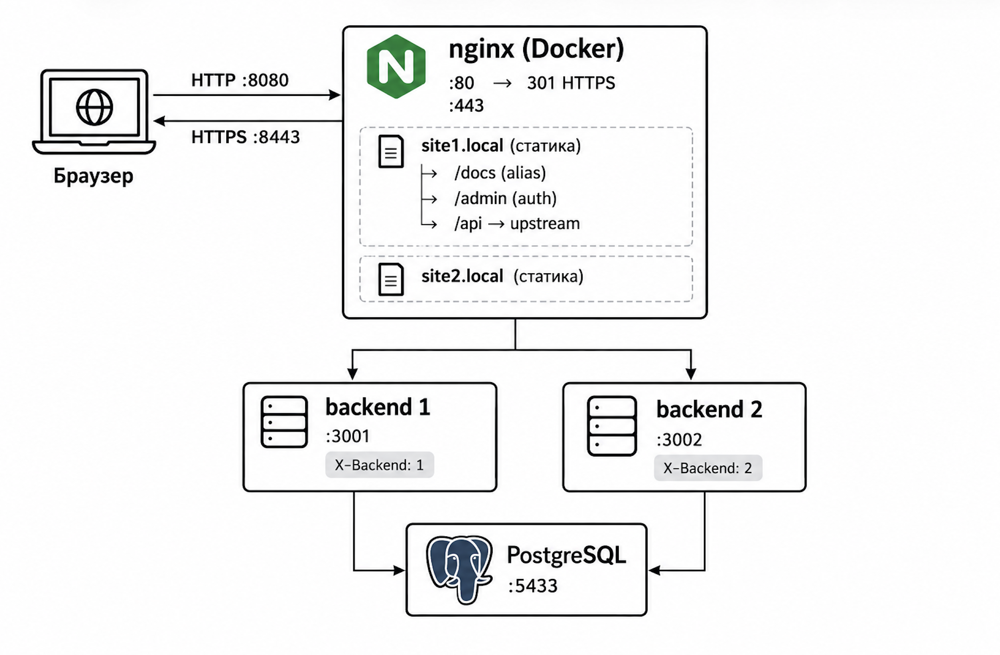

---

## Часть A — HTTPS, редирект, /admin, limit_req

### Что настроили

- Отдельный `server` на порту 80 — только редирект 301 на HTTPS.
- `server` на 443 с самоподписанным сертификатом (`openssl req -x509`).
- `limit_req_zone` — зона 10 МБ, лимит 5 запросов/сек, burst=5.
- `/admin/` закрыт Basic Auth, файл `htpasswd` создан через `httpd:alpine`.

### Проверки

**nginx работает:**

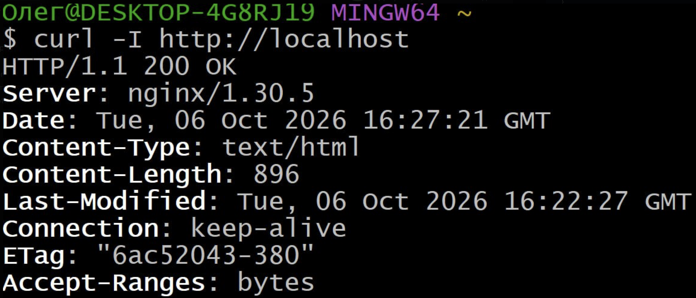

nginx установлен и работает. Команда curl -I http://localhost возвращает 200 OK и заголовок Server: nginx/1.30.5 - nginx работает.

**Генерация сертификата:**

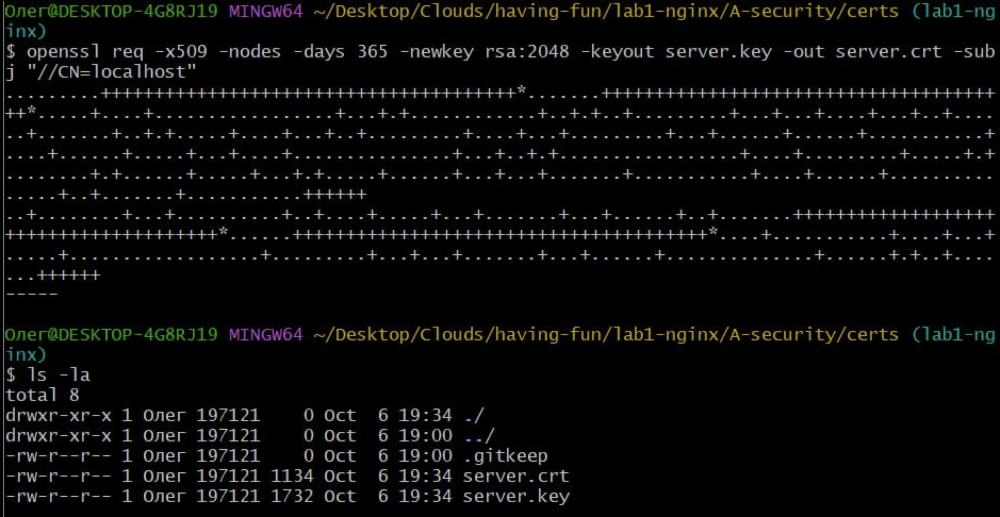

Команда openssl req -x509 создала файлы server.crt (1134 байта) и server.key (1732 байта) в папке lab1-nginx/A-security/certs/

**Создание htpasswd:**

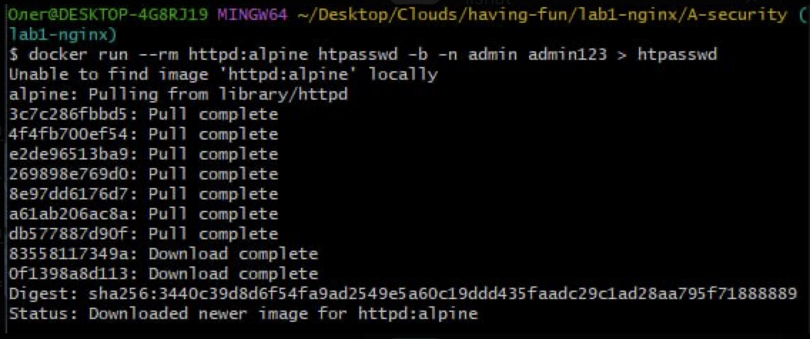

Логин admin, пароль admin123. Хеш в формате APR1 — nginx использует его для директивы auth_basic_user_file.

**Проверка 1 — HTTP редиректит на HTTPS:**

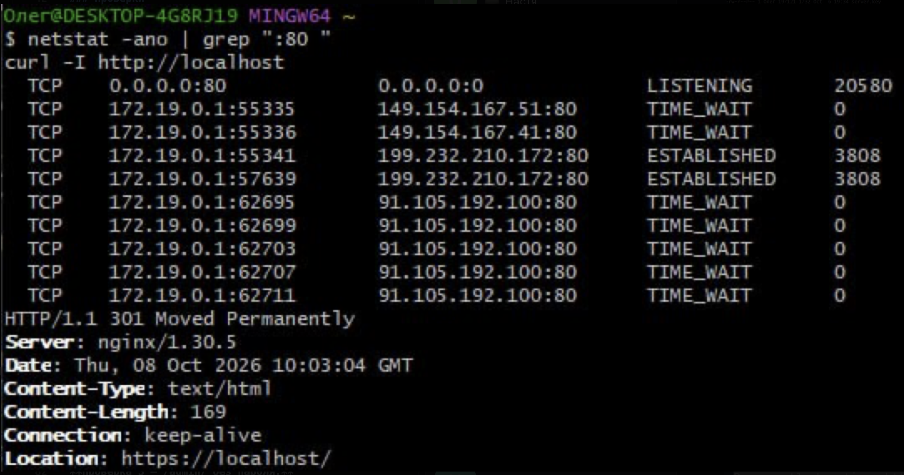

HTTP-запрос на порт 80 перенаправляется на HTTPS. Ответ 301 Moved Permanently, Location: https://localhost/.

**Проверка 2 — HTTPS работает:**

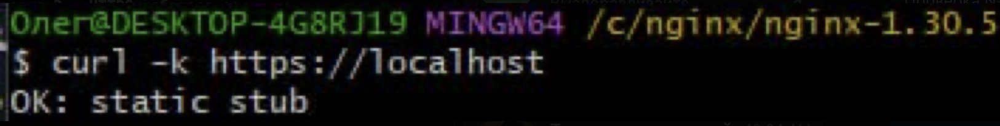

**Проверка 3 — /admin/ без пароля:**

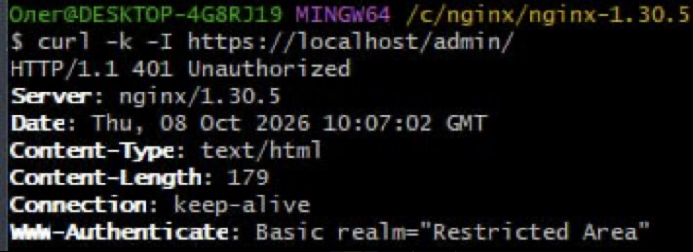

Запрос /admin/ без авторизации возвращает 401 Unauthorized и требует Basic-аутентификации

**Проверка 4 — /admin/ с паролем:**

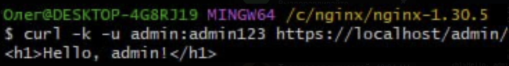

Запрос /admin/ с логином admin и паролем admin123 возвращает страницу администратора.

**Проверка 5 — /api/ одиночный запрос:**

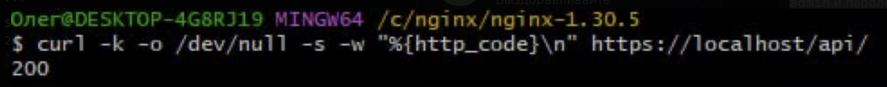

Одиночный запрос к /api/ возвращает 200 OK — лимит не срабатывает

**Проверка 6 — флуд 30 параллельными запросами:**

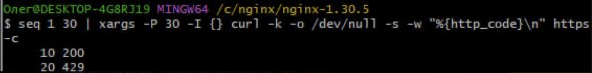

Флуд 30 параллельными запросами к /api/. Результат: 10 запросов — 200 OK, 20 — 429 Too Many Requests. Директива limit_req работает.

**Проверка 7 — восстановление лимита:**

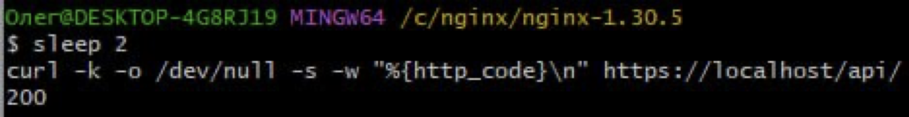

После паузы 2 секунды запрос снова возвращает 200 OK — лимит восстанавливается.

---

## Часть Б — два бэкенда, upstream, failover

### Что настроили

- В `backend/main.py` — middleware, выставляющий заголовок `X-Backend: N` (N из переменной `BACKEND_ID`).
- В `00-upstream.conf` — `upstream backend` с двумя серверами (3001 и 3002), `max_fails=2 fail_timeout=10s`.
- Оба бэкенда запускаются на разных портах, БД общая (PostgreSQL 5433).

### Запуск

```
BACKEND_ID=1 python -m uvicorn main:app --host 127.0.0.1 --port 3001
BACKEND_ID=2 python -m uvicorn main:app --host 127.0.0.1 --port 3002
```

### Проверка 1 — оба бэкенда отвечают напрямую и по-разному

Запрос к 3001 возвращает `X-Backend: 1`, запрос к 3002 — `X-Backend: 2`. Это доказывает, что бэкенды запущены и каждый возвращает свой ID.

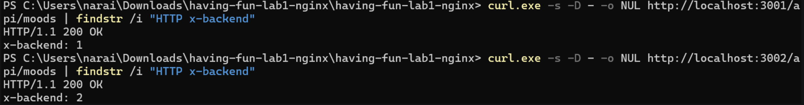

### Проверка 2 — конфиг nginx валидный

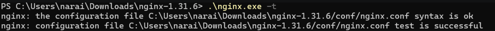

### Проверка 3 — балансировка (чередование X-Backend 1 и 2)

6 запросов через nginx на порт 8080 → `/api/moods`. Ответы чередуются между двумя бэкендами.

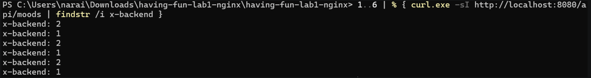

### Проверка 4 — failover (бэкенд 1 остановлен)

Останавливаем бэкенд на порту 3001 (`Ctrl+C` в окне uvicorn). В логах видно `Shutting down` → `Finished server process`. После этого все 6 запросов через nginx идут на бэкенд 2.

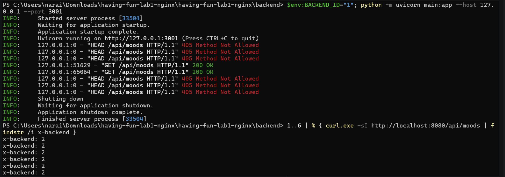

**Ключевое:** сайт пережил падение половины бэкенда — nginx увёл трафик на живой инстанс, сервис продолжает отвечать.

### Проверка 5 — восстановление (бэкенд 1 поднят снова)

Запускаем бэкенд 1 заново, ждём ~11 секунд (в upstream `fail_timeout=10s` — после этого nginx снова пробует упавший узел). Чередование вернулось.

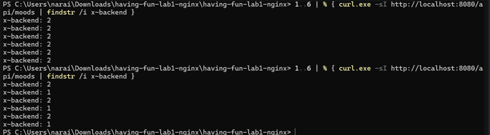

---

## Часть В — виртуальные хосты, /docs через alias, кастомная 404

### Что настроили

- Три `server`-блока: default (ловит чужие/неизвестные Host и ничего не отдаёт), `site1.local` (статика + `/docs` + `/api`), `site2.local` (своя статика, без `/docs` и `/api`).
- `/docs/` отдаётся через `alias /var/www/lab1/docs/` — видно, что URL `/docs/...` мапится в отдельный каталог.
- Свои страницы ошибок: `errors/404.html` (с текстом `CUSTOM-404`) и `errors/50x.html`. Подключаются через `error_page` в `30-errors.conf`.
- Файлы ошибок отдаются через `location /errors/ { internal; alias ...; }` — напрямую по URL недоступны.

### Запуск

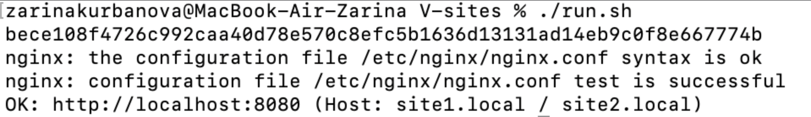

### Проверка 1 — site1.local отдаётся (200 + контент)

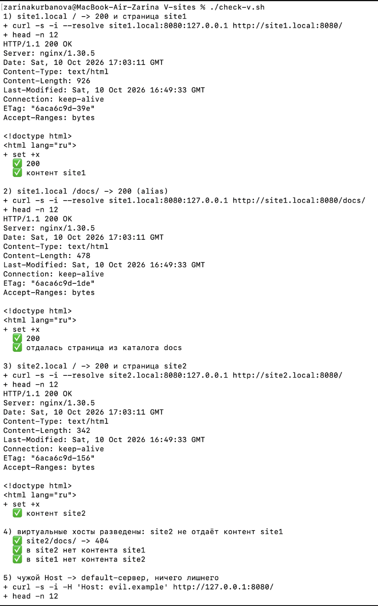
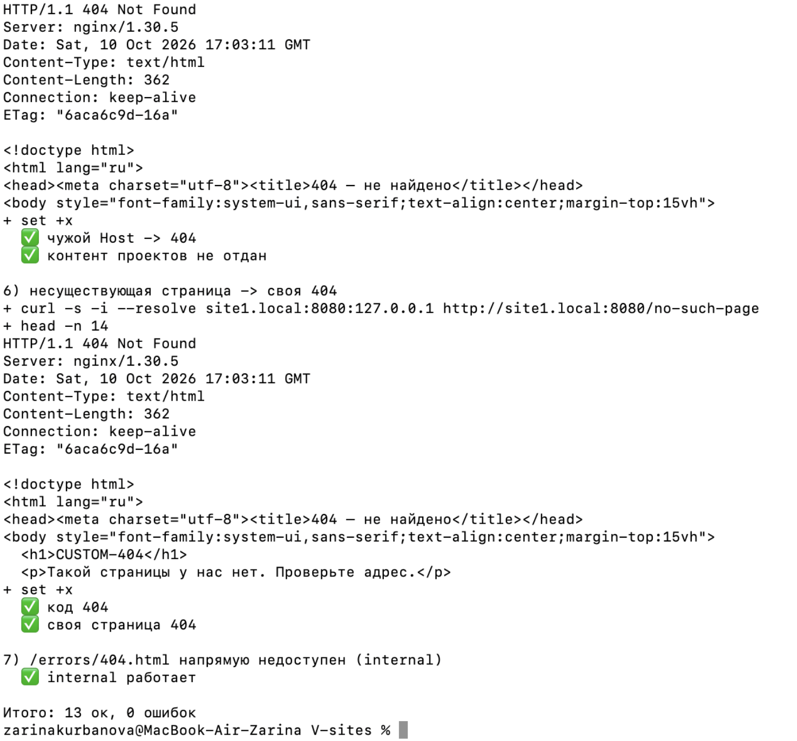


### Проверка 2 — /docs/ через alias

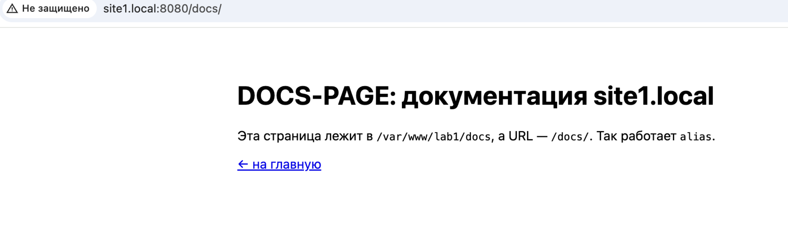

### Проверка 3 — site1.local в браузере

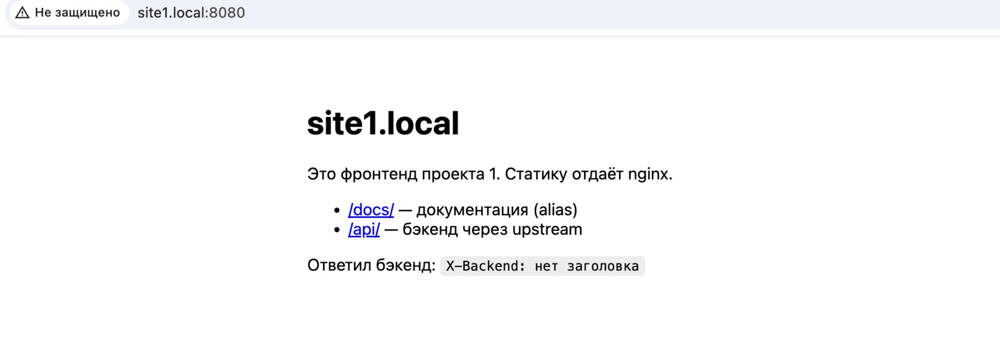

### Проверка 4 — site2.local отдаётся и содержит свой контент

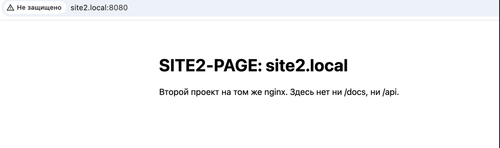

### Проверка 5 — несуществующая страница → своя 404

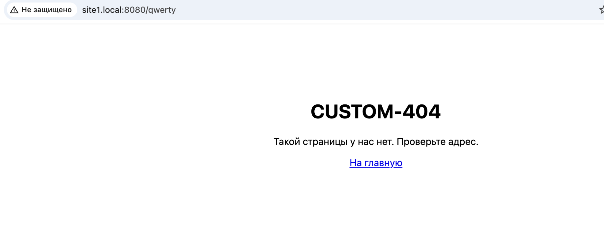

### Конфиги

**`20-sites.conf`** — три server-блока: default на 80, `site1.local` со статикой и alias на `/docs/`, `site2.local` со своей статикой:

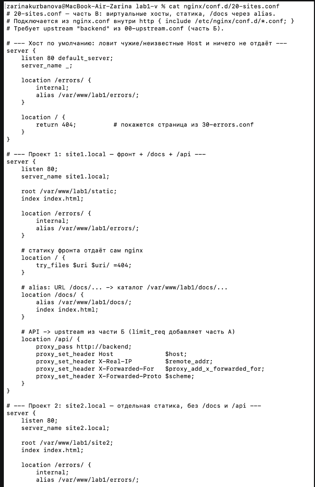
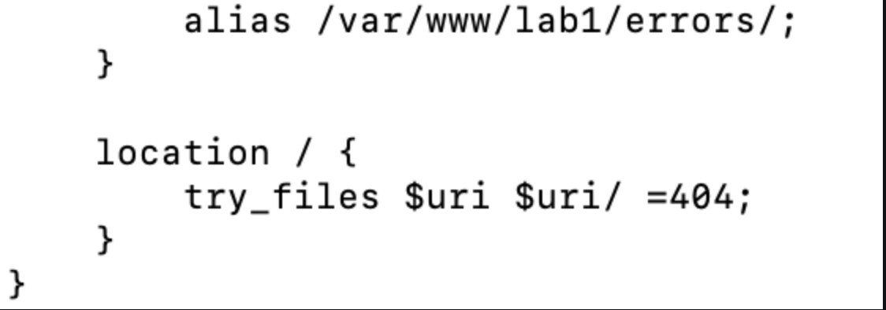

**`30-errors.conf`** — подключает свои страницы для 404 и 50x:
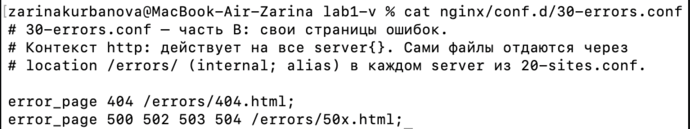

### Итог по части В

Все проверки пройдены: `13 ок, 0 ошибок`. Виртуальные хосты разведены, `/docs/` работает через alias, `/errors/` доступен только как internal, свои страницы 404 и 50x подключены.

---

## Часть Г — сборка (моя)

### Собранные файлы 

- **`nginx.conf`** — склеивает все конфиги через `include /etc/nginx/conf.d/*.conf;`.
- **`run.sh`** — поднимает nginx в докере с нужными маунтами.
- **`check.sh`** — 7 проверок из задания.
- **`www/admin/index.html`** — статика для `/admin/`.

### Скрин запуска

**`./run.sh` — конфиг валиден, nginx поднят:**

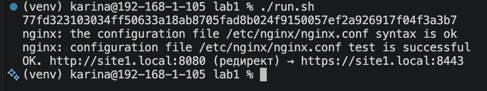

**`docker ps` — оба контейнера Up:**

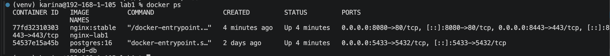

### Балансировка — чередование 1 / 2

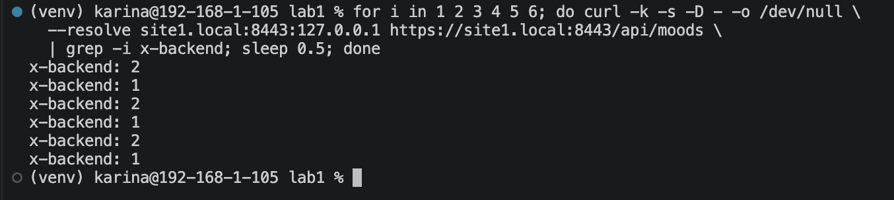

### Failover — после Ctrl+C на бэкенде 1 все ответы от 2

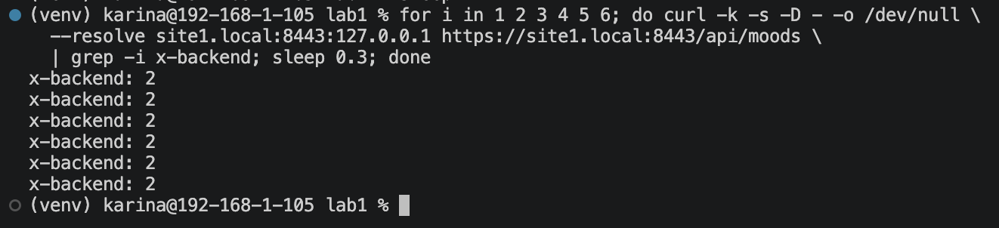

### Проверки в браузере

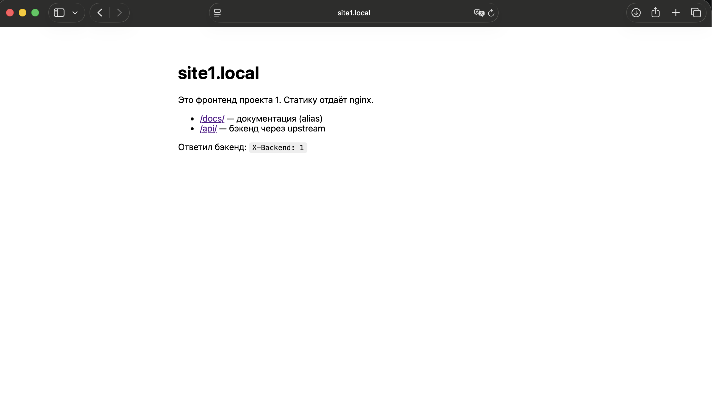
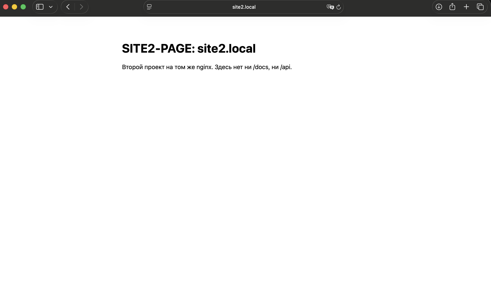
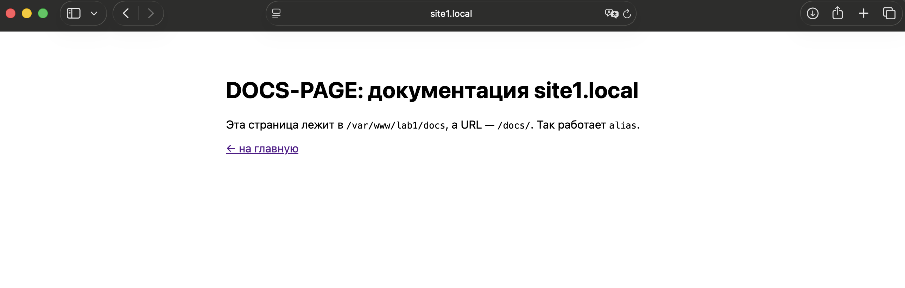
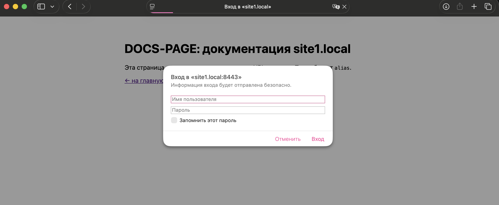
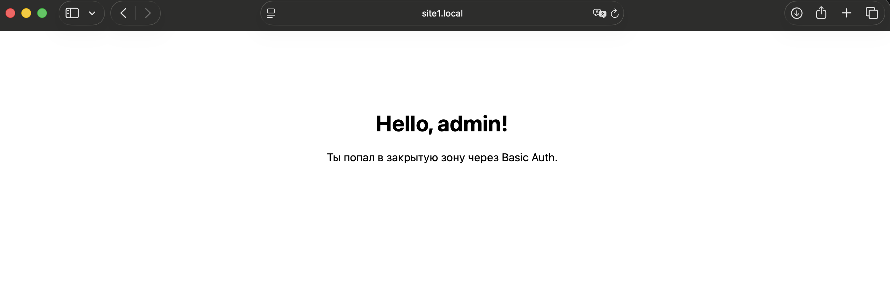

---

## Проверки (7 пунктов задания) — сводный вывод `./check.sh`

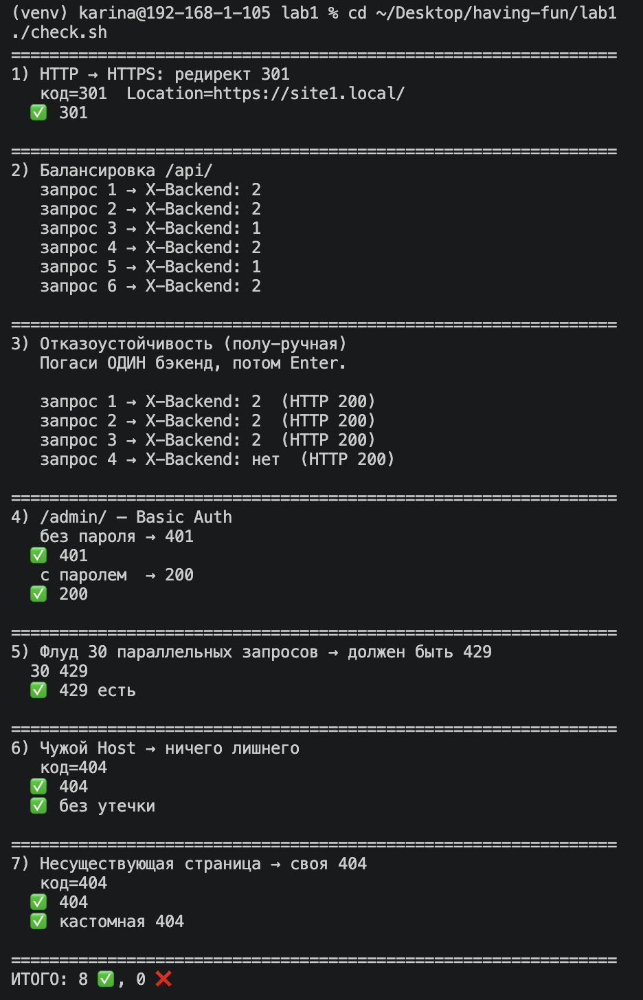

---

## Задание со звёздочкой: проверка уязвимостей nginx

Для проверки безопасности выбран сайт `https://wiki.backboost.ru/`. Это сайт дисциплины "ООП". Проверены 
три уязвимости: заголовки безопасности, перебор директорий и доступ 
к служебным файлам.
### Проверка 1. Заголовки безопасности
Проверили, какие заголовки безопасности отдаёт сервер. Эти заголовки заставляют браузер включать защиту от кликджекинга, XSS и downgrade-атак. Если их нет, то сайт уязвим.

Команда `curl -I https://wiki.backboost.ru/` возвращает `HTTP/1.1 200 OK`. 

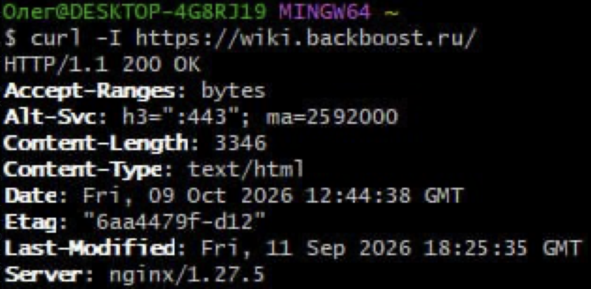

Сервер не отдаёт ни одного из основных заголовков безопасности:
- `Strict-Transport-Security`. отсутствует принудительный HTTPS
- `X-Frame-Options`. сайт можно встроить в iframe (кликджекинг)
- `X-Content-Type-Options`. браузер может угадывать MIME-тип
- `Content-Security-Policy`.нет защиты от XSS
- `Referrer-Policy`. Referer утекает на сторонние ресурсы

Также раскрыта точная версия nginx/1.27.5 в заголовке Server.

Результат: уязвимость обнаружена.

### Проверка 2. Перебор директорий (ffuf)
Проверили, доступны ли на сервере скрытые пути админ-панели, бэкапы, служебные файлы. Это делается автоматическим перебором типовых имён по словарю.

Перебор выполнен утилитой `ffuf` со словарём(https://github.com/danielmiessler/SecLists/blob/master/Discovery/Web-Content/common.txt) 
(4752 типовых имени файлов и папок). Скорость ограничена 
10 запросами в секунду. Проверялись ответы с кодами 200, 301, 302, 403.
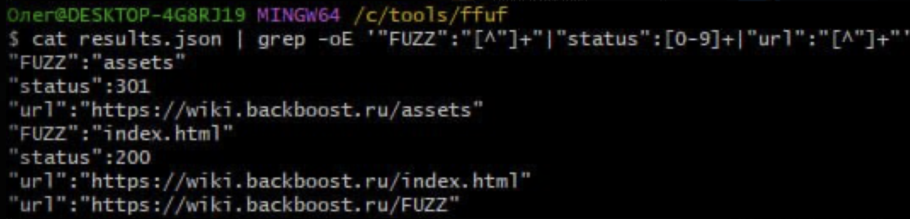
Найдено всего 2 пути:
- `/assets`. 301, редирект на папку со статикой;
- `/index.html`. 200, главная страница сайта.

Админ-панели, бэкапы, служебные файлы , тестовые скрипты 
не обнаружены. Сервер корректно возвращает `404 Not Found` 
на несуществующие пути.

**Результат:** уязвимость не обнаружена.

### Проверка 3. Служебные файлы
Проверили доступ к служебным файлам. При неправильной конфигурации nginx они могут утечь и раскрыть исходный код, пароли от БД и дамп базы.

Проверили четыре самых часто утекающих служебных файла:
`.git/config`, `.env`, `backup.sql`, `phpinfo.php`
 Все четыре проверки вернули `404 Not Found`, следовательно файлов на сервере нету. 
 
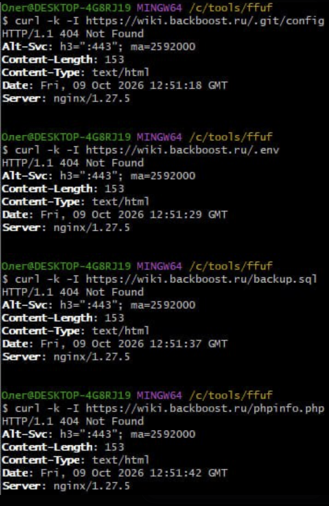

**Результат:** уязвимость не обнаружена.

### Итог:
Из трёх проверок только одна показала уязвимости - отсутствие 
заголовков безопасности и раскрытие версии сервера. 