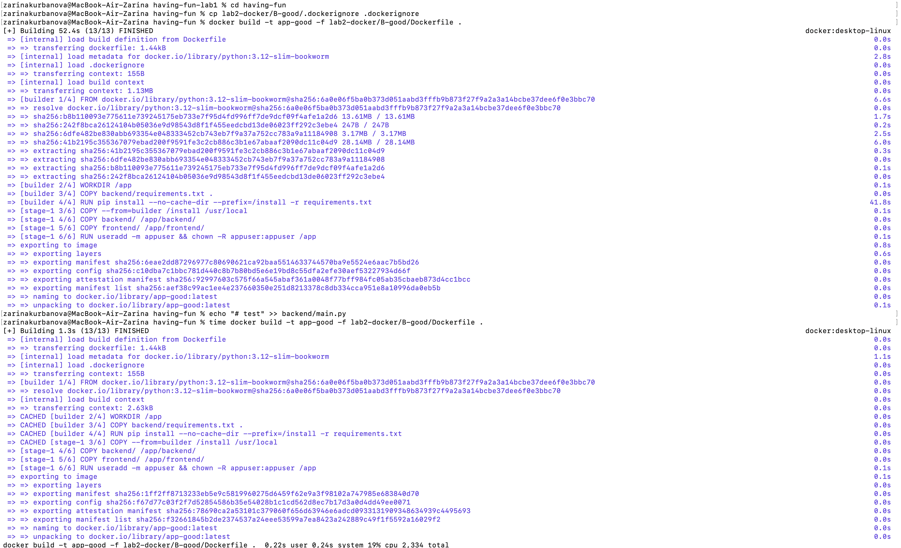
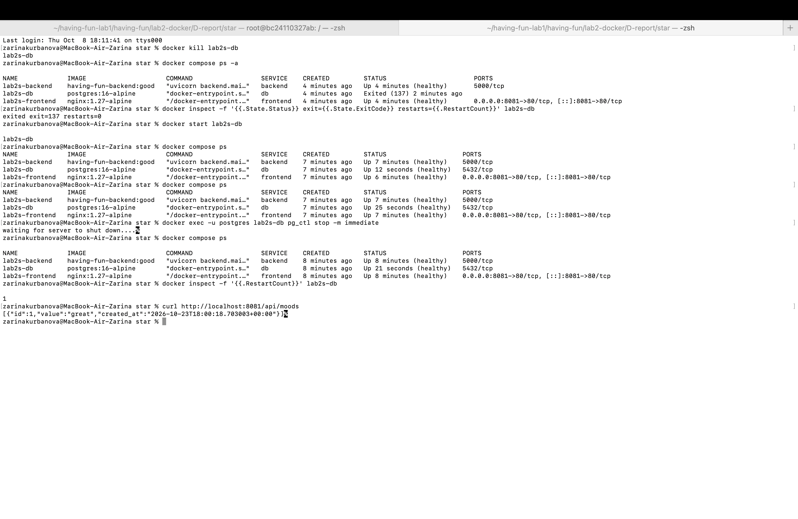
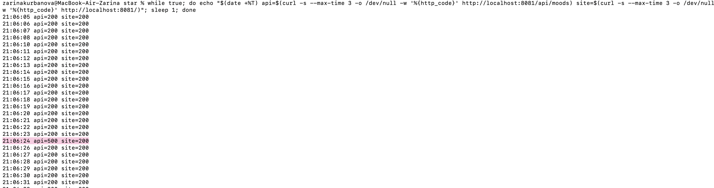
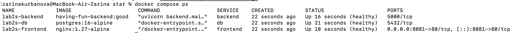
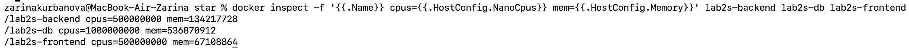
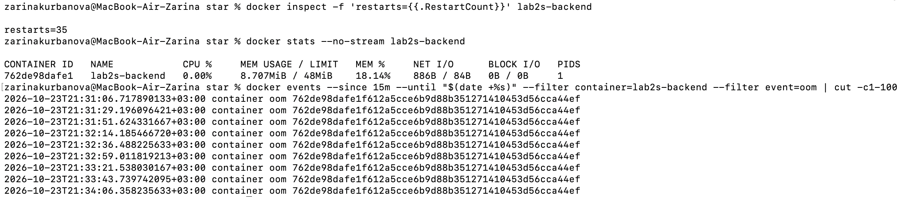
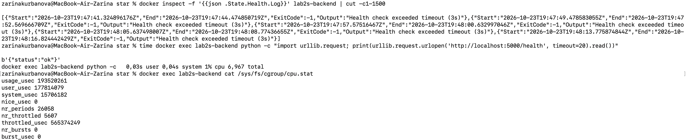
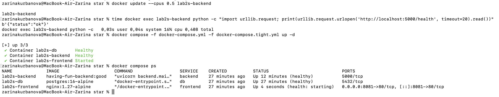
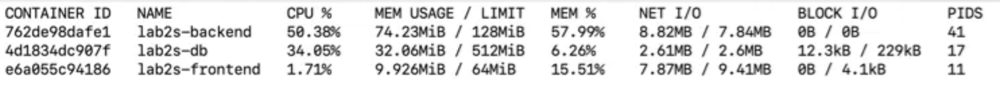
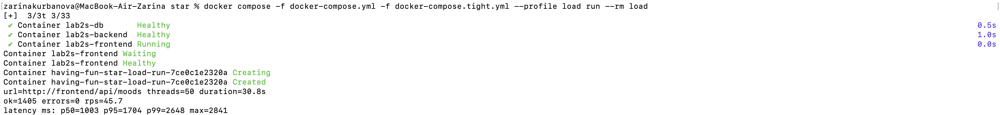

# Лабораторная работа 2. Docker

Мы взяли наше приложение из Лабы 0 («настроение»: бэкенд на FastAPI, база PostgreSQL и простенький фронт) и засунули его в Docker. Сначала сделали два образа, плохой и хороший, и сравнили их. Потом подняли всё вместе через `docker compose`. А ещё сделали вариант со звёздочкой: чтобы стек сам чинился и не съедал все ресурсы.

## 1. Что делаем и как проверяем

- Делаем два образа бэкенда. В плохом специально собираем кучу ошибок, в хорошем всё исправляем: multi-stage сборка, отдельный пользователь, зафиксированная версия базы, `.dockerignore`, `HEALTHCHECK` и правильный порядок слоёв, чтобы работал кеш.
- Сравниваем образы по трём вещам: размер, под каким пользователем работает контейнер и сколько времени занимает пересборка после правки одной строки кода.
- Поднимаем стек из трёх сервисов (бэкенд, фронт, база) одной командой. Данные базы должны переживать пересоздание контейнера, а фронт не должен достучаться до базы напрямую.
- Со звёздочкой: стек сам оживает после падения базы, а у сервисов стоят лимиты по процессору и памяти.

## 2. Как мы договорились делить работу и названия

Чтобы не созваниваться, один раз зафиксировали общие названия, и каждый работал в своей папке.

| Что | Название |
| --- | --- |
| Порт бэкенда | `5000` |
| Проверка здоровья | `/health` |
| Сервисы в compose | `db`, `backend`, `frontend` |
| Сети | `backend-net`, `frontend-net` |
| Том | `db_data` (compose добавляет к нему имя проекта, получается `having-fun_db_data`) |
| Пользователь в контейнере | `appuser` |
| Образы | `app-bad`, `app-good` |
| Папки | `A-bad/`, `B-good/`, `C-compose/`, `D-report/` |

## 3. Часть A. Плохой Dockerfile

Вот он (`A-bad/Dockerfile`), в комментариях `BAD` написано, что тут не так:

```dockerfile
# BAD #1: не зафиксирована версия python.
# При следующей сборке может подтянуться другая версия (3.13, 4.x)
# и приложение внезапно сломается.
# Хорошо: FROM python:3.12-slim-bookworm
FROM python:latest

WORKDIR /app

# BAD #2: COPY . . стоит ДО установки зависимостей.
# Любая правка в ЛЮБОМ файле проекта инвалидирует этот слой,
# а значит и следующий за ним pip install. кеш слоёв не работает вообще.
# Хорошо: сначала COPY backend/requirements.txt, потом pip install,
# и только потом COPY . .
COPY . .

# BAD #3: pip install без --no-cache-dir.
# Кеш pip (десятки МБ wheels) остаётся внутри слоя и раздувает образ.
# Хорошо: RUN pip install --no-cache-dir -r backend/requirements.txt
RUN pip install -r backend/requirements.txt

# Нет .dockerignore — поэтому COPY . . втянул в образ .git/, lab1/,
# lab1-nginx/, demo-lab1/, screenshot.png и все картинки.
# Это тоже bad practice, но реализуется ОТСУТСТВИЕМ файла, а не строкой.

# BAD #4: нет инструкции USER. контейнер запускается от root.
# Если в приложении найдут RCE, атакующий получит root в контейнере.
# Хорошо: RUN useradd -m appuser  +  USER appuser

EXPOSE 5000

CMD ["uvicorn", "backend.main:app", "--host", "0.0.0.0", "--port", "5000"]
```

### Что в нём плохого и как это исправлено в хорошем

| № | Что плохого | Почему это плохо | Как исправили |
| --- | --- | --- | --- |
| 1 | `FROM python:latest` | Версия не зафиксирована. Завтра выйдет новая, сборка подтянет её, и всё может сломаться. Ещё образ получается огромный | `python:3.12-slim-bookworm`: конкретная версия и облегчённая |
| 2 | `COPY . .` стоит до `pip install` | Любая правка в любом файле сбрасывает кеш, и зависимости ставятся заново | Сначала копируем только `requirements.txt`, ставим зависимости, и только потом копируем код |
| 3 | `pip install` без `--no-cache-dir` | Кеш pip остаётся в образе и зря его раздувает | Добавили `--no-cache-dir` |
| 4 | Нет `.dockerignore` | В образ попадает всё подряд: `.git`, папки прошлых лаб, картинки | Добавили `.dockerignore` |
| 5 | Нет `USER`, всё работает от root | Если приложение взломают, у атакующего сразу права root в контейнере | Создали `appuser` и запускаем от него |

### Скриншоты

Сборка (первая заняла 75.4 с):


Размер образа, 491 МБ:


Строка в `backend/main.py`, которую мы поменяли перед замером:


Пересборка после правки, 27.6 с. `pip install` отработал заново (11.7 с):


## 4. Часть B. Хороший Dockerfile

Вот он (`B-good/Dockerfile`):

```dockerfile
# ==========================================
# СТАДИЯ 1: Сборщик
# ==========================================

FROM python:3.12-slim-bookworm AS builder

WORKDIR /app

# Cначала копируем ТОЛЬКО requirements
COPY backend/requirements.txt .

# Ставим зависимости без кеша, чтобы не раздувать образ
RUN pip install --no-cache-dir --prefix=/install -r requirements.txt

# ==========================================
# СТАДИЯ 2: Финальный легкий образ 
# ==========================================
FROM python:3.12-slim-bookworm

WORKDIR /app

# Забираем установленные пакеты из стадии 1
COPY --from=builder /install /usr/local

# Копируем исходный код приложения
COPY backend/ /app/backend/
COPY frontend/ /app/frontend/

# Создаем непривилегированного пользователя
RUN useradd -m appuser && chown -R appuser:appuser /app
USER appuser

EXPOSE 5000

# Healthcheck без установки curl (используем встроенный python)
HEALTHCHECK --interval=30s --timeout=5s --start-period=5s --retries=3 \
  CMD python -c "import urllib.request; urllib.request.urlopen('http://localhost:5000/health')" || exit 1

CMD ["uvicorn", "backend.main:app", "--host", "0.0.0.0", "--port", "5000"]
```

И `.dockerignore`, чтобы в сборку не лезло лишнее:

```
.git
.gitignore
node_modules
__pycache__
*.md
venv/
.env
.env.example
lab1-nginx/
lab1/
lab2-docker/
screenshot.png
```

### Что исправили

| Было | Стало |
| --- | --- |
| `python:latest` | `python:3.12-slim-bookworm`, версия зафиксирована |
| `COPY . .` перед `pip install` | сначала `requirements.txt` и установка, потом код. Поменяли код, зависимости берутся из кеша |
| `pip install` без флага | с `--no-cache-dir` |
| Нет `.dockerignore` | есть |
| Работает от root | работает от `appuser` |
| Один этап сборки | multi-stage: в первом этапе ставим зависимости, во второй берём только готовый результат |
| Нет проверки здоровья | `HEALTHCHECK` на `/health` (без curl, он сделан через python) |

### Скриншоты

Сборка:


Размер:


Под каким пользователем работает контейнер (`whoami` отвечает `appuser`):


Статус `healthy`:


## 5. Сравниваем образы

### Размер

| | Плохой (`app-bad`) | Хороший (`app-good`) |
| --- | --- | --- |
| Размер образа | 491 МБ | 62.4 МБ |
| Место на диске | 1.81 ГБ | 286 МБ |

Хороший образ меньше примерно в 8 раз. Тут сработало сразу три вещи: лёгкая версия Python вместо полной, multi-stage (инструменты сборки в итоговый образ не попадают) и `--no-cache-dir`.

### Пересборка после правки одной строки

| | Плохой образ | Хороший образ |
| --- | --- | --- |
| Первая сборка | 75.4 с | 52.4 с (`pip install` из них 41.8 с) |
| Пересборка после правки одной строки в `backend/main.py` | 27.6 с, `pip install` запустился заново (11.7 с) | 2.33 с, `pip install` взялся из кеша (`CACHED`) |

Получилось, что хороший образ пересобирается примерно в 12 раз быстрее. Честности ради: плохой образ мерили на Windows, а хороший на Mac, так что точные секунды сравнивать не стоит. Но разница в десять раз получилась не из-за компьютеров, а из-за кеша.

Для хорошего образа правили строку так: дописали комментарий `# test` в конец `backend/main.py`. Вот что получилось (все слои до `pip install` помечены `CACHED`, заново собрались только копирование кода и создание пользователя):



### Почему такая разница

Docker запоминает каждый слой образа, и если слой не изменился, второй раз его не собирает. Но если изменился один слой, все слои после него пересобираются.

В плохом образе `COPY . .` стоит перед `pip install`. Поменяли одну строку в коде, слой с копированием поменялся, значит, и `pip install` после него надо делать заново. Каждый раз качаем все библиотеки.

В хорошем образе мы сначала отдельно копируем `requirements.txt` и ставим зависимости, а код копируем уже потом. Поменяли код, пересобрался только последний кусок, а библиотеки остались в кеше. Поэтому 2 секунды вместо почти 30.

Пока мы смотрели на цифры 27 секунд и 2 секунды, у нас был примерно такой вид:


## 6. Часть C. Compose, том и сети

Файл `C-compose/docker-compose.yml`:

```yaml
name: having-fun

services:
  db:
    image: postgres:16-alpine
    container_name: lab2-db
    restart: unless-stopped
    environment:
      POSTGRES_USER: ${POSTGRES_USER:-mood}
      POSTGRES_PASSWORD: ${POSTGRES_PASSWORD:-mood_password}
      POSTGRES_DB: ${POSTGRES_DB:-mood_db}
    volumes:
      - db_data:/var/lib/postgresql/data
    networks:
      - backend-net
    healthcheck:
      test: ["CMD-SHELL", "pg_isready -U $${POSTGRES_USER} -d $${POSTGRES_DB}"]
      interval: 5s
      timeout: 3s
      retries: 10

  backend:
    build:
      context: ../..
      dockerfile: lab2-docker/B-good/Dockerfile
    image: having-fun-backend:good
    container_name: lab2-backend
    restart: unless-stopped
    environment:
      DB_HOST: db
      DB_PORT: "5432"
      BACKEND_ID: compose
      POSTGRES_USER: ${POSTGRES_USER:-mood}
      POSTGRES_PASSWORD: ${POSTGRES_PASSWORD:-mood_password}
      POSTGRES_DB: ${POSTGRES_DB:-mood_db}
    depends_on:
      db:
        condition: service_healthy
    networks:
      - backend-net
      - frontend-net
    healthcheck:
      test: ["CMD", "python", "-c", "import urllib.request; urllib.request.urlopen('http://localhost:5000/health')"]
      interval: 5s
      timeout: 3s
      retries: 10
      start_period: 5s

  frontend:
    image: nginx:1.27-alpine
    container_name: lab2-frontend
    restart: unless-stopped
    ports:
      - "8080:80"
    volumes:
      - ./nginx.conf:/etc/nginx/conf.d/default.conf:ro
      - ../../frontend:/usr/share/nginx/html:ro
    depends_on:
      backend:
        condition: service_healthy
    networks:
      - frontend-net

volumes:
  db_data:

networks:
  backend-net:
  frontend-net:
```

Конфиг nginx для фронта (раздаёт страницу и пересылает `/api/` на бэкенд):

```nginx
server {
    listen 80;
    server_name _;

    root /usr/share/nginx/html;
    index index.html;

    location / {
        try_files $uri $uri/ =404;
    }

    location /api/ {
        proxy_pass http://backend:5000;
        proxy_set_header Host              $host;
        proxy_set_header X-Real-IP         $remote_addr;
        proxy_set_header X-Forwarded-For   $proxy_add_x_forwarded_for;
        proxy_set_header X-Forwarded-Proto $scheme;
    }

    location = /health {
        proxy_pass http://backend:5000/health;
    }
}
```

| Сервис | Образ | Сети | Порт наружу |
| --- | --- | --- | --- |
| db | `postgres:16-alpine` | `backend-net` | нет |
| backend | собирается из `B-good/Dockerfile` | `backend-net` и `frontend-net` | нет |
| frontend | `nginx:1.27-alpine` | `frontend-net` | 8080 |

Бэкенд сидит в обеих сетях, а база только в одной. Поэтому до базы может достучаться только бэкенд.

### Проверка 1. Всё поднимается одной командой

`docker compose up -d`:


`docker compose ps`, все три сервиса работают (у базы и бэкенда статус healthy):


### Проверка 2. Данные не пропадают

Добавили запись о настроении, удалили контейнер базы (`docker rm -f lab2-db`), подняли заново, запись на месте. Данные лежат в томе, а не в самом контейнере, так что контейнер можно удалять сколько угодно.


### Проверка 3. Фронт не видит базу

Фронт и база не сидят ни в одной общей сети, поэтому фронт даже не знает, что такое `db` (ошибка `bad address 'db'`). А бэкенд до базы спокойно достучался.


Все три проверки прошли с первого раза:


## 7. Со звёздочкой. Устойчивый стек

Всё лежит в `D-report/star/`: [`docker-compose.yml`](D-report/star/docker-compose.yml), [`docker-compose.tight.yml`](D-report/star/docker-compose.tight.yml) и [`loadgen.py`](D-report/star/loadgen.py). Подробные команды и таблицы с результатами в [`D-report/star/README.md`](D-report/star/README.md).

### Что настроили

| | db | backend | frontend |
| --- | --- | --- | --- |
| `healthcheck` (проверка здоровья) | `pg_isready` каждые 5 с | запрос на `/health` каждые 5 с | `wget` на главную каждые 5 с |
| `restart` (перезапуск) | `unless-stopped` | `unless-stopped` | `unless-stopped` |
| `depends_on` (кто кого ждёт) | ничего не ждёт | ждёт, пока база станет `healthy` | ждёт, пока бэкенд станет `healthy` |
| Лимиты (итоговые, подобраны нагрузкой) | 1 CPU, 512 МБ | 0.5 CPU, 128 МБ | 0.5 CPU, 64 МБ |

Бэкенд при каждом запросе открывает новое соединение с базой. Поэтому пока база лежит, API отвечает ошибкой, а как только база снова поднялась, всё работает без перезапуска бэкенда.

### Роняем базу

Сначала мы записали в базу настроение через API, потом запустили в одном окне терминала «мониторинг»: он раз в секунду стучится на сайт и на API и пишет время и коды ответа. Во втором окне уронили базу.

**Первая попытка не сработала.** Мы сделали `docker kill lab2s-db`, и база не поднялась: Docker считает `kill` и `stop` ручной остановкой и политику `restart` в таком случае не применяет. Контейнер остался в статусе `Exited (137)`, `RestartCount=0`, а API всё это время отвечал 500, пока мы не запустили базу руками. Вывод: чтобы проверить самовосстановление, падение нужно имитировать как настоящую аварию, а не командой «остановить».



**Вторая попытка.** Аварийно остановили postgres изнутри контейнера: `docker exec -u postgres lab2s-db pg_ctl stop -m immediate`. Контейнер вышел сам, и Docker поднял его обратно по `restart: unless-stopped`. После этого у базы `RestartCount=1`, она снова `healthy`, а наша запись на месте.

В мониторинге при этом один ответ `api=500` (в 21:06:24), через пару секунд снова 200. Сайт всё время отвечал 200. Бэкенд не перезапускался: он просто открыл новое соединение с базой, когда она вернулась.



Стек до этого (все три сервиса `healthy`):



Итог: база упала, стек сам её поднял, `curl` снова отвечает. Команды повторить можно по `D-report/star/README.md`.

### Лимиты под нагрузкой

Идея такая: сначала ставим слишком тесные лимиты и смотрим, что ломается, потом поднимаем, пока не станет стабильно. Нагрузку давали маленькой программкой (`loadgen.py`): 50 параллельных потоков 30 секунд долбят `/api/moods` через nginx, бэкенд и базу. Лимиты меняли прямо на работающих контейнерах командой `docker update`.

**Что получилось на каждом шаге:**

| Шаг | Лимиты | Что произошло |
| --- | --- | --- |
| 1 | бэкенд 0.10 CPU / 48 МБ | Бэкенд не может жить: его убивает по нехватке памяти (OOM) каждые ~22 секунды. За ~10 минут 35 перезапусков, Docker пишет события `oom`. Фронт даже не стартует, потому что ждёт здорового бэкенда |
| 2 | бэкенд 0.10 CPU / 128 МБ | Память теперь хватает, но бэкенд всё равно `unhealthy`: проверка здоровья не успевает за 3 секунды. Мы замерили её вручную, она занимает **7.56 с**. Счётчик Docker показал, что процессору урезали время в 2771 из 4871 периодов (57%). Это и есть троттлинг |
| 3 | бэкенд 0.25 CPU | Проверка занимает 3.27 с, всё ещё чуть дольше 3 секунд |
| 4 | бэкенд 0.5 CPU | Проверка 0.41 с, бэкенд `healthy`, весь стек поднялся |
| 5 | нагрузка, база 0.25 CPU / 64 МБ | Из ~5900 запросов успешных только 205, остальные ошибки 500, всего 5 запросов в секунду. База при этом перезапускалась (`RestartCount=8`). Лимиты базы оказались слишком тесными |
| 6 | нагрузка, база 1 CPU / 512 МБ | **1405 запросов, ошибок 0**, 45.7 запросов в секунду, p95 около 1.7 с. Стабильно |

**Итоговые лимиты:** бэкенд 0.5 CPU / 128 МБ, база 1 CPU / 512 МБ, фронт 0.5 CPU / 64 МБ (они уже записаны в `docker-compose.yml` звёздочки). Под нагрузкой бэкенд использует 50% CPU (упирается в свой лимит) и 74 МБ из 128, база 34% CPU и 32 МБ из 512.

Скриншот с настроенными лимитами:



Первые лимиты: бэкенд в цикле OOM (35 перезапусков, события `oom`):



Следующий шаг: память есть, но CPU 0.10, и проверка здоровья не проходит (7.56 с против тайм-аута 3 с) плюс счётчики троттлинга. Скриншот сделан при повторе опыта: проверка заняла 6.97 с, а счётчики копятся с запуска контейнера (включая прогоны нагрузки), поэтому цифры больше, чем в таблице: `nr_throttled` 5607 из 26058 периодов, `throttled_usec` около 565 с:



Подняли CPU до 0.5 (на 0.25 проверка занимала 3.27 с, всё ещё дольше тайм-аута), проверка стала занимать 0.41 с, и стек поднялся целиком:



`docker stats` под нагрузкой на итоговых лимитах:



Результат нагрузки на итоговых лимитах: 1405 запросов, ошибок нет (прогон на тесной базе дал 5739 ошибок, цифры в таблице выше):



## 8. Что поняли

- Плохой образ получился 491 МБ и работает от root, а пересборка после правки одной строки занимает почти полминуты. Хороший 62.4 МБ, работает от `appuser`, пересобирается за пару секунд.
- Том отделяет данные от контейнера, а две сети не дают фронту добраться до базы.
- `healthcheck` вместе с `depends_on` решает, кто за кем стартует, `restart` поднимает упавшее, а лимиты не дают одному сервису съесть все ресурсы.

Лаба сделана:


## 9. Как повторить

    git clone -b lab2-docker https://github.com/karka-g/having-fun.git
    cd having-fun

    # положить .dockerignore в корень, иначе docker build с флагом -f его не увидит
    cp lab2-docker/B-good/.dockerignore .dockerignore

    # плохой и хороший образы
    docker build -t app-bad  -f lab2-docker/A-bad/Dockerfile  .
    docker build -t app-good -f lab2-docker/B-good/Dockerfile .
    docker images | grep app-

    # обычный стек
    cd lab2-docker/C-compose && docker compose up -d --build && docker compose ps
    docker exec lab2-backend whoami        # должно ответить appuser

    # устойчивый стек (звёздочка)
    cd ../D-report/star && docker compose up -d --build

Финальный запуск с чистого клона: `D-01-final-up.png` (ЗАПОЛНИТЬ).

## Что ещё осталось сделать (убрать перед сдачей)

1. Загрузить скриншот `D-03-timing-comparison.png` в `D-report/screenshots/` и мемы `meme-dab.jpg`, `meme-clock.jpg`, `meme-done.jpg` в `D-report/memes/`.
2. Положить скриншоты звёздочки в `D-report/star/screenshots/`: `S-01-ps-healthy.png`, `S-02-kill-db.png`, `S-02-recovery.png`, `S-03-limits-config.png`, `S-04-stats-tight.png`, `S-04b-cpu-steps.png`, `S-05-oom.png`, `S-06-stats-load.png`, `S-06-load-result.png`.
3. Проверить всё с чистого клона и сделать `D-01-final-up.png`.
4. Удалить этот список.
