# Лабораторная работа 2. Docker

Сервис из Лабы 0 (приложение «настроение»: FastAPI + PostgreSQL + статичный фронт) упаковываем в образы и поднимаем весь стек через `docker compose`.

> **Заметка для команды (удалить перед сдачей).** Места, которые нужно закрыть до сдачи, помечены словом «ЗАПОЛНИТЬ». Список в конце файла.

## 1. Цель и что проверяется

- Сделать два образа бэкенда: «плохой» с не менее чем тремя bad practices и «хороший» с их исправлением (multi-stage, непривилегированный пользователь, зафиксированная версия базы, `.dockerignore`, `HEALTHCHECK`, порядок слоёв под кеш).
- Сравнить образы: размер, пользователь в контейнере, время пересборки после правки одной строки кода.
- Поднять стек из трёх сервисов (бэкенд, фронт, БД) одной командой `docker compose up`; данные БД должны переживать пересоздание контейнера; фронт не должен иметь сетевого доступа к БД.
- Со звёздочкой: самовосстановление стека и лимиты ресурсов под нагрузкой.

## 2. Договорённости по интерфейсу

| Параметр | Значение |
| --- | --- |
| Порт бэкенда | `5000` |
| Health-эндпоинт | `/health` |
| Сервисы в compose | `db`, `backend`, `frontend` |
| Сети | `backend-net`, `frontend-net` |
| Том | `db_data` (в compose-проекте получает префикс: `having-fun_db_data`) |
| Пользователь в контейнере | `appuser` |
| Образы | `app-bad`, `app-good` |
| Папки | `A-bad/`, `B-good/`, `C-compose/`, `D-report/` |

## 3. Часть A. Плохой Dockerfile

Файл `A-bad/Dockerfile`:

```dockerfile
# BAD #1: не зафиксирована версия python.
# При следующей сборке может подтянуться другая версия (3.13, 4.x)
# и приложение внезапно сломается.
# Хорошо: FROM python:3.12-slim-bookworm
FROM python:latest

WORKDIR /app

# BAD #2: COPY . . стоит ДО установки зависимостей.
# Любая правка в ЛЮБОМ файле проекта инвалидирует этот слой,
# а значит и следующий за ним pip install. кеш слоёв не работает вообще.
# Хорошо: сначала COPY backend/requirements.txt, потом pip install,
# и только потом COPY . .
COPY . .

# BAD #3: pip install без --no-cache-dir.
# Кеш pip (десятки МБ wheels) остаётся внутри слоя и раздувает образ.
# Хорошо: RUN pip install --no-cache-dir -r backend/requirements.txt
RUN pip install -r backend/requirements.txt

# Нет .dockerignore — поэтому COPY . . втянул в образ .git/, lab1/,
# lab1-nginx/, demo-lab1/, screenshot.png и все картинки.
# Это тоже bad practice, но реализуется ОТСУТСТВИЕМ файла, а не строкой.

# BAD #4: нет инструкции USER. контейнер запускается от root.
# Если в приложении найдут RCE, атакующий получит root в контейнере.
# Хорошо: RUN useradd -m appuser  +  USER appuser

EXPOSE 5000

CMD ["uvicorn", "backend.main:app", "--host", "0.0.0.0", "--port", "5000"]
```

### Какие bad practices реализованы

| № | Bad practice | Чем плохо | Как исправлено в хорошем образе |
| --- | --- | --- | --- |
| 1 | `FROM python:latest` | Версия базы не зафиксирована: следующая сборка может подтянуть другую мажорную версию и сломать приложение; образ тяжёлый (полный Debian) | `FROM python:3.12-slim-bookworm`: конкретная версия и лёгкий вариант |
| 2 | `COPY . .` до `pip install` | Правка любого файла инвалидирует слой, и зависимости ставятся заново. Кеш слоёв не работает | Сначала `COPY backend/requirements.txt`, затем `pip install`, и только потом копируется код |
| 3 | `pip install` без `--no-cache-dir` | Кеш pip остаётся в слое и раздувает образ | `pip install --no-cache-dir` |
| 4 | Нет `.dockerignore` | `COPY . .` втягивает в образ `.git/`, `lab1/`, картинки и прочий мусор, контекст сборки раздувается | Добавлен `.dockerignore` |
| 5 | Нет `USER`, запуск от root | При компрометации приложения атакующий получает root в контейнере | `useradd appuser` + `USER appuser` |

### Скриншоты

Сборка образа (первая сборка 75.4 с):

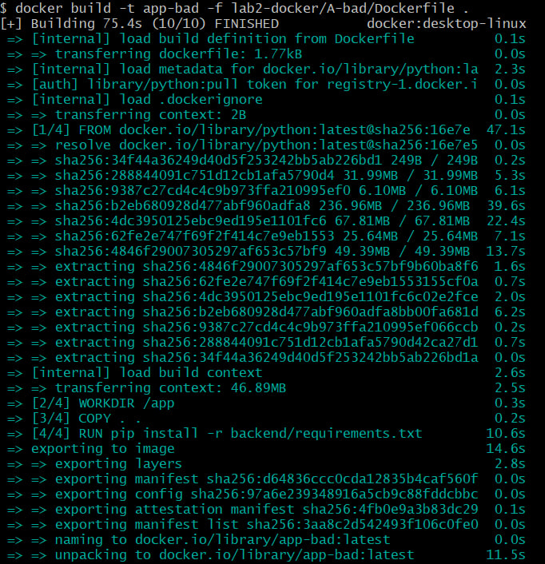

Размер образа (491 МБ content, 1.81 ГБ disk usage):

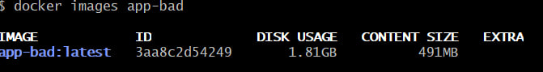

Строка в `backend/main.py`, которую правили перед замером:

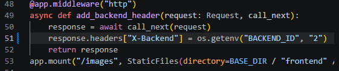

Пересборка после правки (27.6 с, `pip install` выполнился заново за 11.7 с):

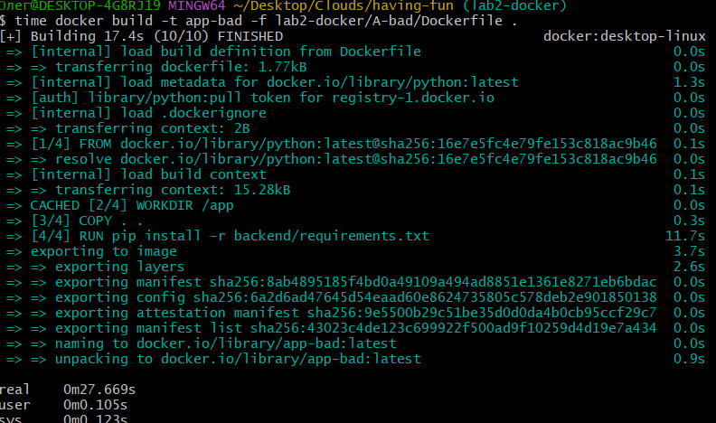

## 4. Часть B. Хороший Dockerfile

Файл `B-good/Dockerfile`:

```dockerfile
# ==========================================
# СТАДИЯ 1: Сборщик
# ==========================================

FROM python:3.12-slim-bookworm AS builder

WORKDIR /app

# Cначала копируем ТОЛЬКО requirements
COPY backend/requirements.txt .

# Ставим зависимости без кеша, чтобы не раздувать образ
RUN pip install --no-cache-dir --prefix=/install -r requirements.txt

# ==========================================
# СТАДИЯ 2: Финальный легкий образ 
# ==========================================
FROM python:3.12-slim-bookworm

WORKDIR /app

# Забираем установленные пакеты из стадии 1
COPY --from=builder /install /usr/local

# Копируем исходный код приложения
COPY backend/ /app/backend/
COPY frontend/ /app/frontend/

# Создаем непривилегированного пользователя
RUN useradd -m appuser && chown -R appuser:appuser /app
USER appuser

EXPOSE 5000

# Healthcheck без установки curl (используем встроенный python)
HEALTHCHECK --interval=30s --timeout=5s --start-period=5s --retries=3 \
  CMD python -c "import urllib.request; urllib.request.urlopen('http://localhost:5000/health')" || exit 1

CMD ["uvicorn", "backend.main:app", "--host", "0.0.0.0", "--port", "5000"]
```

Файл `B-good/.dockerignore`:

```
.git
.gitignore
node_modules
__pycache__
*.md
venv/
.env
.env.example
lab1-nginx/
lab1/
lab2-docker/
screenshot.png
```

### Что исправлено (bad -> good)

| Было (плохой образ) | Стало (хороший образ) |
| --- | --- |
| `python:latest` | `python:3.12-slim-bookworm`, версия зафиксирована |
| `COPY . .` перед `pip install` | `requirements.txt` -> `pip install` -> код: при правке кода слой с зависимостями берётся из кеша |
| `pip install` без `--no-cache-dir` | с `--no-cache-dir` |
| Нет `.dockerignore` | есть `.dockerignore` |
| Запуск от root | пользователь `appuser`, `USER appuser` |
| Один этап сборки | multi-stage: `builder` ставит зависимости в `/install`, финальный образ забирает только их |
| Нет проверки здоровья | `HEALTHCHECK` на `/health` без установки curl (используется python) |

### Скриншоты

Сборка:

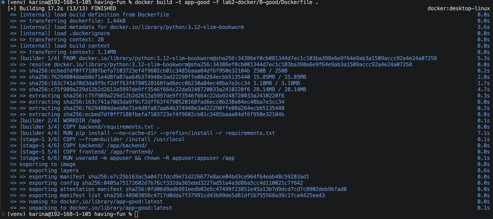

Размер хорошего образа:

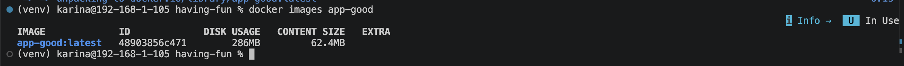

Пользователь в контейнере (`whoami` -> `appuser`):

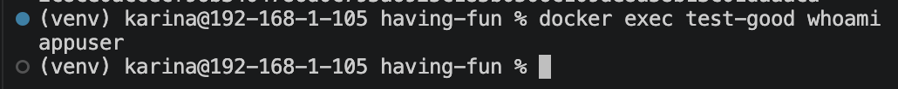

HEALTHCHECK (статус `healthy`):

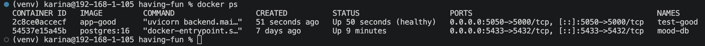

Замер пересборки:

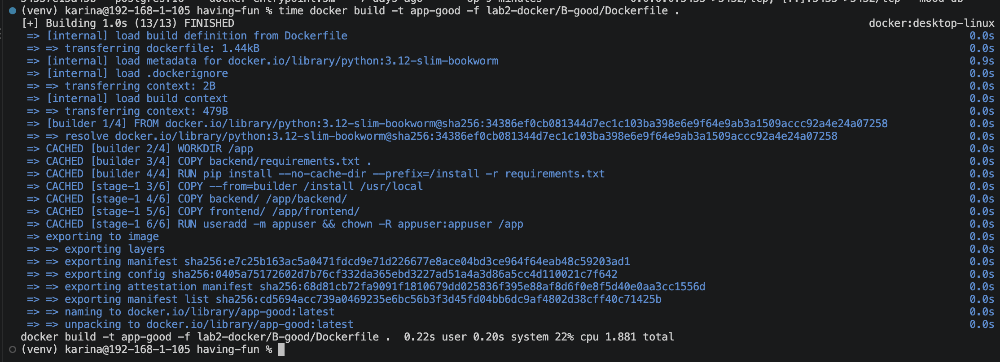

## 5. Сравнение образов

### Размер

| | Плохой (`app-bad`) | Хороший (`app-good`) |
| --- | --- | --- |
| Content size | 491 МБ | 62.4 МБ |
| Disk usage | 1.81 ГБ | 286 МБ |

Хороший образ меньше плохого примерно в 8 раз по content size и в 6 раз по disk usage. Основной вклад: slim-вариант базы вместо полного `python:latest`, multi-stage (в финальный образ не попадают инструменты сборки) и `--no-cache-dir`.

### Время пересборки после правки одной строки

| | Плохой образ | Хороший образ |
| --- | --- | --- |
| Первая сборка | 75.4 с | ЗАПОЛНИТЬ |
| Пересборка после правки одной строки в `backend/main.py` | 27.6 с (`pip install` выполнился заново, 11.7 с) | ЗАПОЛНИТЬ (см. заметку ниже) |
| Пересборка без изменений кода (все слои в кеше) | не измерялось | 1.88 с |

> **Заметка для команды (удалить перед сдачей).** На скриншоте `B-05-timing.png` все слои помечены `CACHED`, включая `COPY backend/`. Значит, перед замером код не правили, и 1.88 с это пересборка без изменений, а не после правки одной строки, как требует методичка. Сравнивать её с 27.6 с у плохого образа некорректно. Перемерить нужно так (из корня репозитория):
>
>     # правим одну строку, например комментарий в backend/main.py
>     time docker build -t app-good -f lab2-docker/B-good/Dockerfile .
>
> Ожидание: слои до `pip install` берутся из кеша (`CACHED`), пересобираются только `COPY backend/` и последующие, то есть несколько секунд. Результат подставить в таблицу выше вместо ЗАПОЛНИТЬ, а скриншот добавить как `D-03-timing-comparison.png` или заменить `B-05`. Замеры A и B также сделаны на разных машинах (Windows/git bash и macOS), поэтому абсолютные значения сопоставимы лишь приблизительно.

### Объяснение разницы

В плохом образе `COPY . .` стоит до `pip install`. Docker кеширует слои по содержимому: стоит измениться любому файлу в контексте, слой `COPY . .` инвалидируется, а вместе с ним все слои после него, включая `pip install`. Поэтому правка одной строки кода заставляет заново скачивать и ставить все зависимости (11.7 с из 27.6 с пересборки и экспорт тяжёлого образа).

В хорошем образе порядок обратный: `requirements.txt` копируется и ставится отдельным слоем, код копируется после него. При правке кода меняется только слой `COPY backend/` и то, что за ним, а слой с зависимостями остаётся в кеше. Кроме того, образ значительно меньше, поэтому экспорт слоёв тоже быстрее.

## 6. Часть C. Compose, том, сеть

Файл `C-compose/docker-compose.yml`:

```yaml
name: having-fun

services:
  db:
    image: postgres:16-alpine
    container_name: lab2-db
    restart: unless-stopped
    environment:
      POSTGRES_USER: ${POSTGRES_USER:-mood}
      POSTGRES_PASSWORD: ${POSTGRES_PASSWORD:-mood_password}
      POSTGRES_DB: ${POSTGRES_DB:-mood_db}
    volumes:
      - db_data:/var/lib/postgresql/data
    networks:
      - backend-net
    healthcheck:
      test: ["CMD-SHELL", "pg_isready -U $${POSTGRES_USER} -d $${POSTGRES_DB}"]
      interval: 5s
      timeout: 3s
      retries: 10

  backend:
    build:
      context: ../..
      dockerfile: lab2-docker/B-good/Dockerfile
    image: having-fun-backend:good
    container_name: lab2-backend
    restart: unless-stopped
    environment:
      DB_HOST: db
      DB_PORT: "5432"
      BACKEND_ID: compose
      POSTGRES_USER: ${POSTGRES_USER:-mood}
      POSTGRES_PASSWORD: ${POSTGRES_PASSWORD:-mood_password}
      POSTGRES_DB: ${POSTGRES_DB:-mood_db}
    depends_on:
      db:
        condition: service_healthy
    networks:
      - backend-net
      - frontend-net
    healthcheck:
      test: ["CMD", "python", "-c", "import urllib.request; urllib.request.urlopen('http://localhost:5000/health')"]
      interval: 5s
      timeout: 3s
      retries: 10
      start_period: 5s

  frontend:
    image: nginx:1.27-alpine
    container_name: lab2-frontend
    restart: unless-stopped
    ports:
      - "8080:80"
    volumes:
      - ./nginx.conf:/etc/nginx/conf.d/default.conf:ro
      - ../../frontend:/usr/share/nginx/html:ro
    depends_on:
      backend:
        condition: service_healthy
    networks:
      - frontend-net

volumes:
  db_data:

networks:
  backend-net:
  frontend-net:
```

Конфиг фронта `C-compose/nginx.conf` (статика + прокси `/api/` на бэкенд):

```nginx
server {
    listen 80;
    server_name _;

    root /usr/share/nginx/html;
    index index.html;

    location / {
        try_files $uri $uri/ =404;
    }

    location /api/ {
        proxy_pass http://backend:5000;
        proxy_set_header Host              $host;
        proxy_set_header X-Real-IP         $remote_addr;
        proxy_set_header X-Forwarded-For   $proxy_add_x_forwarded_for;
        proxy_set_header X-Forwarded-Proto $scheme;
    }

    location = /health {
        proxy_pass http://backend:5000/health;
    }
}
```

| Сервис | Образ | Сети | Порты хоста |
| --- | --- | --- | --- |
| db | `postgres:16-alpine` | `backend-net` | нет |
| backend | собирается из `B-good/Dockerfile` | `backend-net` + `frontend-net` | нет |
| frontend | `nginx:1.27-alpine` | `frontend-net` | 8080 -> 80 |

### Проверка 1. Стек поднимается одной командой

`docker compose up -d`:

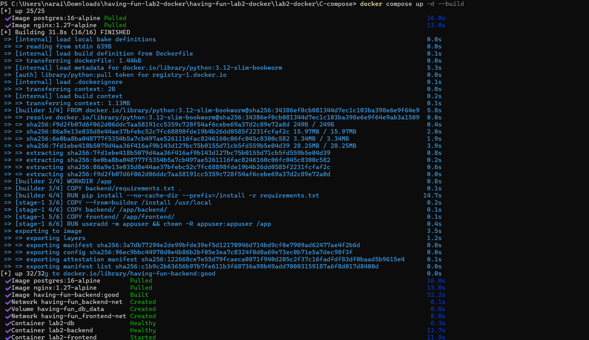

`docker compose ps` (все три сервиса работают, db и backend `healthy`):

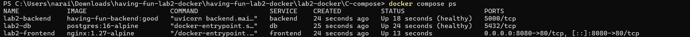

### Проверка 2. Данные переживают пересоздание контейнера

Записываем настроение, удаляем контейнер БД (`docker rm -f lab2-db`), поднимаем стек заново, запись на месте. Том `having-fun_db_data` не принадлежит контейнеру, поэтому остаётся после `docker rm`.

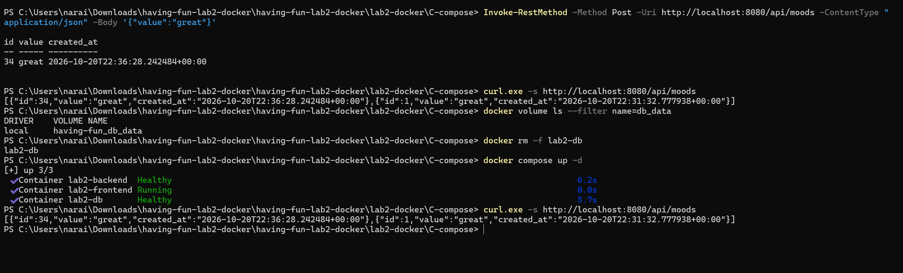

### Проверка 3. Сетевая изоляция

Фронт и БД не делят ни одной сети: фронт даже не может разрешить имя `db` (`bad address 'db'`), а бэкенд, который стоит в обеих сетях, до БД доходит.

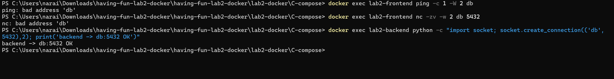

## 7. Со звёздочкой. Устойчивый стек

Подробное описание, команды и таблицы результатов: [`D-report/star/README.md`](D-report/star/README.md). Файлы: [`docker-compose.yml`](D-report/star/docker-compose.yml), [`docker-compose.tight.yml`](D-report/star/docker-compose.tight.yml), [`loadgen.py`](D-report/star/loadgen.py).

### Что настроено

| Механизм | db | backend | frontend |
| --- | --- | --- | --- |
| `healthcheck` | `pg_isready`, 5 с | `GET /health`, 5 с | `wget --spider /`, 5 с |
| `restart` | `unless-stopped` | `unless-stopped` | `unless-stopped` |
| `depends_on` | нет | `db: service_healthy` | `backend: service_healthy` |
| Лимиты (стартовые, финальные подобрать нагрузкой) | 1.0 CPU, 512 МБ | 1.0 CPU, 256 МБ | 0.5 CPU, 64 МБ |

Бэкенд открывает новое соединение с БД на каждый запрос (пула нет), поэтому после падения БД он переподключается сам: пока БД лежит, API отвечает ошибкой, как только БД снова healthy, запросы проходят.

### Самовосстановление: «погасили БД -> стек поднял её сам -> curl снова отвечает»

ЗАПОЛНИТЬ: скриншоты `S-01-ps-healthy.png`, `S-02-kill-db.png`, время восстановления (см. `D-report/star/README.md`, демонстрация 1).

### Лимиты под нагрузкой

ЗАПОЛНИТЬ: выставленные лимиты, `docker stats` под нагрузкой, что произошло на тесных лимитах (троттлинг, OOM), финальные значения (см. `D-report/star/README.md`, демонстрация 2).

## 8. Выводы

- Плохой образ: 491 МБ, root, пересборка после правки одной строки 27.6 с из-за перезапуска `pip install`. Хороший образ: 62.4 МБ, пользователь `appuser`, зависимости вынесены в отдельный слой.
- Именованный том отделяет жизнь данных от жизни контейнера; две сети дают изоляцию: единственный сервис, видящий БД, это бэкенд.
- `healthcheck` + `depends_on: service_healthy` решают проблему порядка старта, `restart` возвращает упавшие сервисы, лимиты ограничивают влияние одного сервиса на остальные.

## 9. Как воспроизвести

    git clone https://github.com/karka-g/having-fun.git
    cd having-fun && git checkout lab2-docker

    # плохой и хороший образы
    docker build -t app-bad  -f lab2-docker/A-bad/Dockerfile  .
    docker build -t app-good -f lab2-docker/B-good/Dockerfile .
    docker images | grep app-

    # обычный стек
    cd lab2-docker/C-compose && docker compose up -d --build && docker compose ps
    docker exec lab2-backend whoami        # appuser

    # устойчивый стек
    cd ../D-report/star && docker compose up -d --build

Скриншот финального запуска с чистого клона: `D-01-final-up.png` (ЗАПОЛНИТЬ).

## Что осталось закрыть перед сдачей

1. Перемерить время пересборки хорошего образа после правки одной строки (см. заметку в разделе 5) и подставить значение.
2. Прогнать демонстрации со звёздочкой, сделать скриншоты в `D-report/star/screenshots/` и заполнить таблицы в `D-report/star/README.md` и разделе 7.
3. Финальная проверка с чистого клона (`D-01-final-up.png`): стек поднимается, размеры совпадают, `whoami` возвращает `appuser`.
4. Удалить заметки для команды и этот список.
