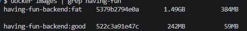
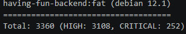
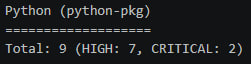
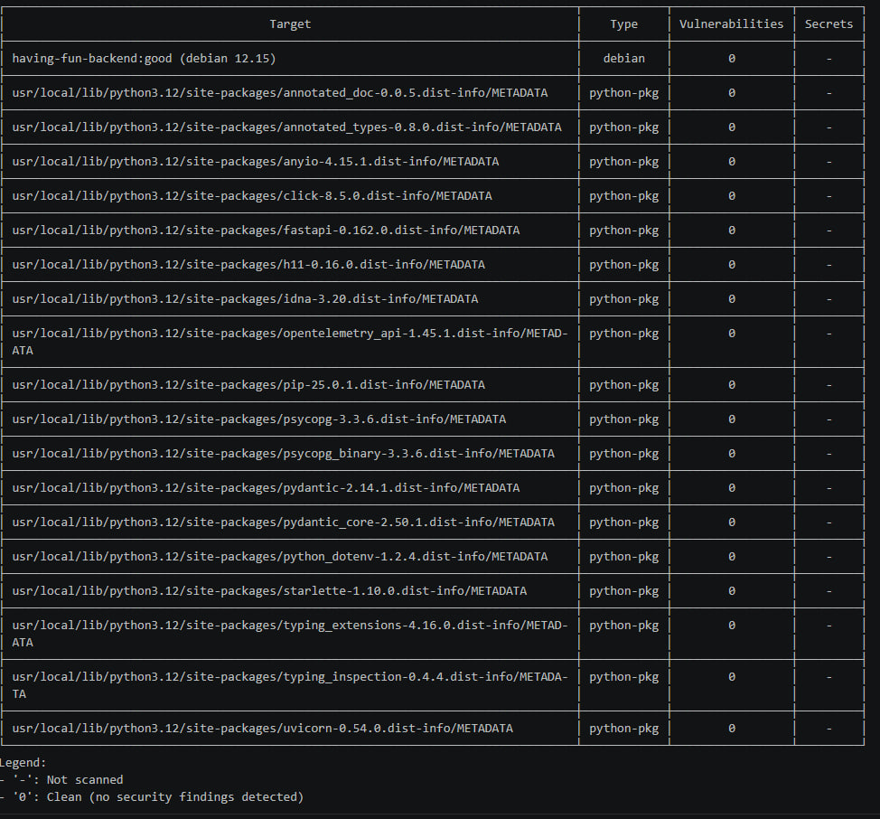
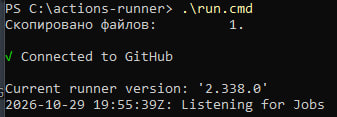

# Часть C — Security-gate (Trivy) + Self-hosted Runner

## 1. Установка Trivy и подготовка образов
Trivy был установлен на Windows-машину для проверки контейнеров на уязвимости.

_Рисунок C-01. Установленная версия Trivy._

Для демонстрации работы сканера были собраны два образа из одного и того же приложения:
1. **«Жирный»** (уязвимый) — на базе устаревшего `python:3.7` (Debian EOL).
2. **«Хороший»** — на базе `python:3.12-slim-bookworm` (взят из Лабы 2).

_Рисунок C-02. Размеры образов — 1.49 ГБ и 242 МБ._

## 2. Сканирование Trivy: до и после

### Сканирование «жирного» образа

_Рисунки C-03a и C-03b. Trivy обнаружил **254 CRITICAL** и **3115 HIGH** уязвимостей в системных пакетах и Python-зависимостях._

### Сканирование «хорошего» образа

_Рисунок C-04. После замены базового образа на актуальный — **0 уязвимостей**._

### Таблица до/после
| Образ | База | CRITICAL | HIGH | Всего |
|---|---|---|---|---|
| `having-fun-backend:fat` | `python:3.7` | **254** | **3115** | **3369** |
| `having-fun-backend:good` | `python:3.12-slim-bookworm` | **0** | **0** | **0** |

**Что чинили:** Заменили устаревший базовый образ (EOL) на актуальный `slim-bookworm`. Это удалило все системные уязвимости и уязвимости Python-пакетов. В пайплайне CI также добавлен флаг `--ignore-unfixed`, чтобы не блокировать сборку на CVE без фиксов.

## 3. Настройка Self-hosted runner
Для возможности автоматического развертывания (деплоя) приложения на локальной машине был настроен self-hosted runner. Облачные runner'ы GitHub (`ubuntu-latest`) не имеют сетевого доступа к локальным компьютерам разработчиков, поэтому стадия деплоя требует собственного агента.

Раннер установлен и запущен на ОС Windows. Он успешно авторизован в GitHub и принимает задачи.

_Рисунок C-05. Локальный runner подключен к GitHub и слушает задачи (`Listening for Jobs`)._

## 4. Работа Security-gate в CI (Интеграция)
*(Этот раздел заполним после того, как Участник 2 запушит `good-pipeline.yml`)*

<!--
После пуша пайплайна сюда будут добавлены скрины:
- C-06: Красный пайплайн (Trivy нашел CRITICAL и заблокировал деплой).
- C-07: Зеленый пайплайн (Trivy пропустил образ, сервис задеплоился).
-->